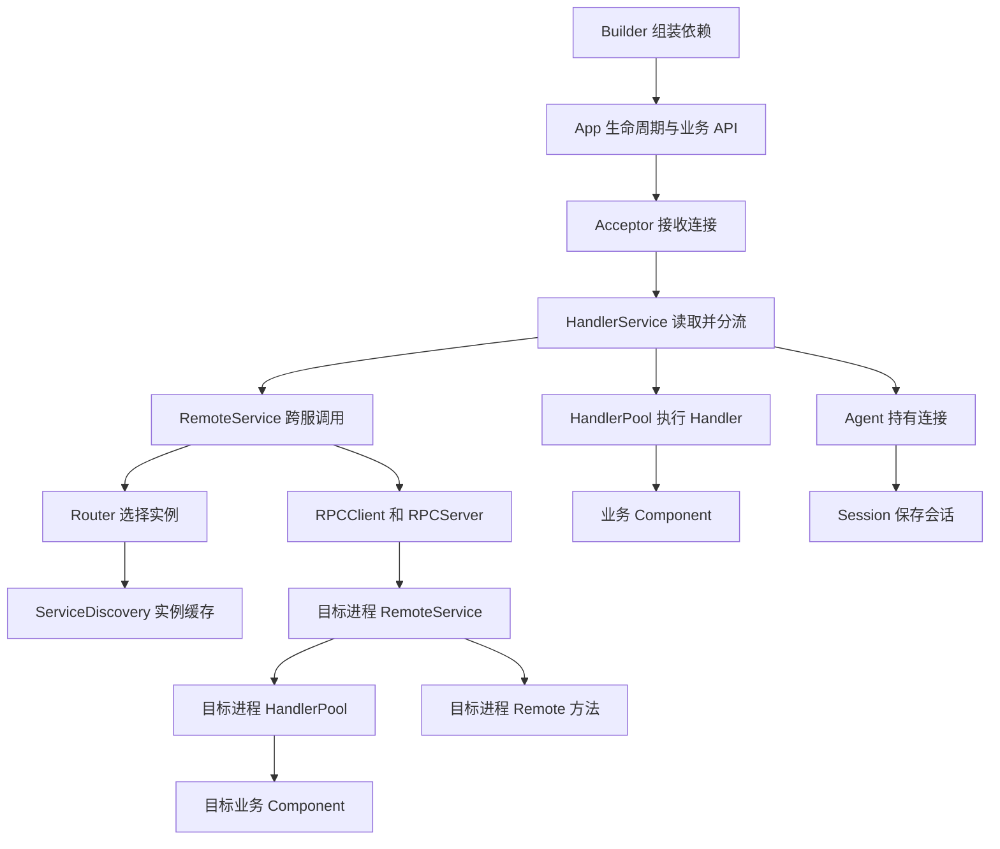
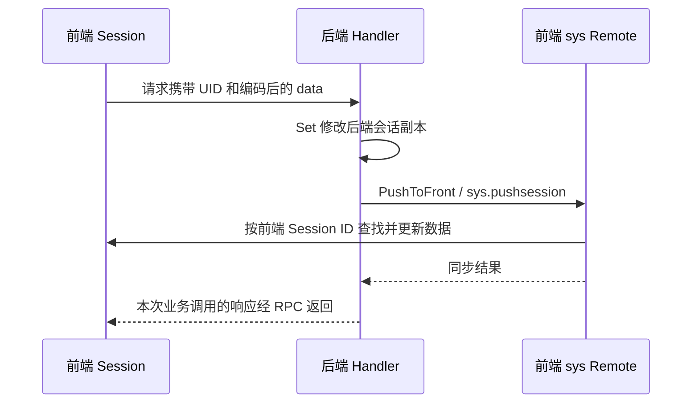

# Pitaya 模块设计详解

Pitaya 把游戏服务端的基础能力拆分为应用组装、连接接入、消息执行、跨服通信和状态管理等模块。理解这些模块时，最有用的问题是：谁持有状态、谁调用谁、在哪个 goroutine 执行，以及失败后哪些操作已经发生。

本文是 [中文学习指南](learning-guide-zh.md) 的深入部分，对应当前 v3 仓库代码，基线为 `776af52`。各节先解释实现，再讨论由实现带来的设计取舍；业务改造建议不代表框架已经提供相应保证。入门时先读第 1 至 7 节，理解集群时读第 8 至 12 节，再读扩展、并发与排障部分。

## 1. 整体结构和依赖方向

### 1.1 四个层次

| 层次 | 主要模块 | 解决的问题 |
| --- | --- | --- |
| 应用组装层 | Builder、App、Component、Module | 选用哪些实现，如何启动与停止 |
| 客户端连接层 | Acceptor、PlayerConn、Packet、Message、Agent | 如何接入连接、识别协议、收发消息 |
| 请求执行层 | HandlerService、HandlerPool、Pipeline、RemoteService | 如何定位业务方法、传递参数、执行和返回 |
| 集群与公共服务层 | Router、ServiceDiscovery、RPC、Session、Group、Worker、Metrics、Tracing | 如何跨进程定位、通信、维护状态和观察运行情况 |

这是阅读上的分层，实际 Go 包之间通过接口和对象引用连接，并非四层各自完全独立。



图中的连接表示主要组装或调用关系。Metrics、Tracing 和 Pipeline 穿插在执行链路中，没有画成独立的串行阶段。

### 1.2 先分清状态的生命周期

| 状态 | 主要持有者 | 存活范围 |
| --- | --- | --- |
| 路由对应的业务方法 | HandlerPool、RemoteService | 注册后通常持续到进程退出 |
| 客户端 socket、发送队列、心跳时间 | 前端 Agent | 一条连接 |
| 前端 Session、UID 索引 | SessionPool | 当前 App 中的在线连接 |
| 后端 Remote Agent 和 Session | 一次转发请求的执行过程 | 不等同于持久在线用户对象 |
| 参数、返回值、请求 context | 本次调用 | 一次请求或其异步后续工作 |
| 服务器实例列表 | ServiceDiscovery 本地缓存，etcd 注册数据 | 随租约和服务发现事件变化 |
| UID 到前端实例的映射 | BindingStorage | 与在线绑定及租约相关 |
| 内存 Group | `groups` 包级共享存储 | 当前进程 |
| Timer 管理器和 ticker | `timer` 包级变量 | 当前进程共享 |
| 异步任务 | Redis 队列和消费 Worker | 可跨越发起请求的生命周期 |

由此可以判断：把房间状态放进一个 Component，就必须考虑其并发访问；把数据放进后端 Session，不等于已经把数据持久化；创建两个 App，也不代表所有包级状态都自动隔离。

## 2. Builder 与 App

源码入口：[builder.go](../pkg/builder.go)、[app.go](../pkg/app.go)。

### 2.1 Builder 是依赖组装入口

`NewBuilder` 创建 Server、SessionPool、Serializer、Router、Hooks、GroupService、Worker 和启用的 Reporter；Cluster 模式还创建默认的 etcd ServiceDiscovery 与 NATS RPC 实现。

Builder 的重要字段对外公开，因此应用可以替换实现。例如 gRPC 示例替换 `RPCClient`、`RPCServer`，再调用 `Build`。这种方式把“使用哪一种通信实现”和“如何执行业务请求”分开，也便于测试注入 mock。

`Build` 的关键步骤是：

1. 新建一个 HandlerPool。
2. 校验模式：Standalone 不允许配置 SD/RPC，Cluster 必须同时有 SD、RPC Client 和 Server。
3. Cluster 模式下，把 SD 交给 Router，把 RPC、Router、Serializer、SessionPool、Hooks 和 HandlerPool 交给 RemoteService。
4. 通过 `RPCServer.SetPitayaServer(remoteService)`，将传输入口接到框架 RPC 实现。
5. 创建 AgentFactory，再用它和同一个 HandlerPool 创建 HandlerService。
6. 创建 App，执行 post-build hooks，返回 `Pitaya` 接口。

这里共享的是 HandlerPool 的实例。因此远端转发来的客户端请求可以调用同一份注册表，不需要再维护一套后端专用 Handler 规则。

`Build` 并非对 Builder 的动态绑定：App 已经取得相关依赖引用，之后重新赋值 Builder 字段不会自动重新组装 App。替换依赖和主要配置应在 `Build` 前完成。

### 2.2 App 是业务入口和生命周期协调者

业务组件通常只保存 `pitaya.Pitaya` 接口，调用 `GetSessionFromCtx`、`RPC`、`GroupBroadcast` 等方法，无需直接接触底层 NATS 或 socket。App 同时保留组件列表、模块列表、服务器信息和依赖引用。

当前启动流程可以按下图阅读：

```text
App.Start
  → 校验前后端与 Acceptor 的搭配
  → Cluster 模式安排 RPC 与 ServiceDiscovery 模块的启动位置
  → 启动周期指标采集
  → App.listen
      → startupComponents：初始化组件并提取方法
      → 创建全局 ticker，启动 Dispatch goroutine
      → 启动 Acceptor，接入客户端连接
      → 按条件注册 UniqueSession
      → startModules：先依次 Init，再依次 AfterInit
      → 标记 running
  → 等待 dieChan 或系统信号
  → 关闭 Session，关闭模块，关闭组件
```

一个容易忽略的顺序是：Acceptor 启动在 `startModules` 之前。因此“TCP 端口已经监听”与“所有依赖已经就绪”不是同一个检查。组件 `AfterInit` 也发生在模块启动前，不应据此假定 RPC 和 SD 已完成初始化。

`Shutdown()` 本身主要关闭 `dieChan` 发出停止信号，实际清理位于 `Start` 的退出路径。启用 Session drain 且收到 SIGTERM 时，还会进入等待会话排空的流程；不能把一次 `Shutdown()` 调用理解为已同步完成所有资源回收。

学习问题：如果想添加另一种 RPC 传输，需要改业务 Handler 吗？如果只是添加一个业务接口，需要改 Builder 吗？从依赖组装和方法注册的边界分别回答。

## 3. Component 与 Module

源码入口：[component.go](../pkg/component.go)、[component/service.go](../pkg/component/service.go)、[component/method.go](../pkg/component/method.go)、[module.go](../pkg/module.go)、[interfaces.go](../pkg/interfaces/interfaces.go)。

### 3.1 Component 组织业务方法

Component 提供 `Init`、`AfterInit`、`BeforeShutdown`、`Shutdown` 四个生命周期方法，通常嵌入 `component.Base` 获得默认空实现，再增加自己的业务方法。

`app.Register` 和 `app.RegisterRemote` 首先将组件及选项加入列表。真正的方法提取发生在 `startupComponents` 中，随后注册进 HandlerService 或 RemoteService。

反射提取会记录接收者、方法、参数类型等元数据。HandlerPool 使用 `service.method` 作为键，因此一次请求的查找无需重新扫描组件的所有方法；但实际执行仍使用反射调用。

| 注册方式 | 请求参数 | 返回值 | 使用者 |
| --- | --- | --- | --- |
| Handler Request | context 后可省略参数，或使用指针、`[]byte` | 指针或 `[]byte`，加 error | 客户端 Request |
| Handler Notify | 同上 | 无 | 客户端 Notify |
| Remote | context 后可省略参数，有参时实现 proto.Message | 实现 proto.Message 的指针，加 error | 显式服务间 RPC |

签名不符合条件的方法不会成为目标路由。方法存在于 Go 类型上，不意味着它已经成为可调用接口。组件名和方法名还受 `WithName`、`WithNameFunc` 影响。

当前 `startupComponents` 分别遍历 Handler 组件列表和 Remote 组件列表。同一个对象同时 Register 与 RegisterRemote，其生命周期回调会分别执行，不能假设系统按对象去重。初始化数据库写入、注册 timer、创建 Group 等操作时，要考虑重复调用的影响。

### 3.2 Module 组织基础设施

`interfaces.Module` 的接口为：

```go
type Module interface {
    Init() error
    AfterInit()
    BeforeShutdown()
    Shutdown() error
}
```

RPC Client、RPC Server、ServiceDiscovery 和 BindingStorage 都可以参与此生命周期。相较 Component，Module 的 Init 和 Shutdown 能返回错误，而且主要通过生命周期参与应用，而不是被反射为客户端路由。

`RegisterModuleBefore` 插到当前全部模块之前，`RegisterModuleAfter` 加到全部模块之后；它们不是“在某个指定名字前后”建立依赖图。所有模块依次 Init 后，再依次 AfterInit；关闭时先逆序 BeforeShutdown，再逆序 Shutdown。

`SessionModule` 在 Module 上增加 `StartSessionDraining` 和 `SessionCount`，用于让具有会话语义的扩展参与退出等待。

扩展选择：一组游戏业务路由使用 Component；需要随进程启停的外部连接、后台协调服务适合 Module。依赖启动顺序时，要对照实际注册次序，不能只看模块名字。

## 4. Acceptor 与协议分层

源码入口：[acceptor.go](../pkg/acceptor/acceptor.go)、[tcp_acceptor.go](../pkg/acceptor/tcp_acceptor.go)、[ws_acceptor.go](../pkg/acceptor/ws_acceptor.go)、[conn](../pkg/conn)、[serializer.go](../pkg/serialize/serializer.go)。

### 4.1 接收连接与处理请求分离

Acceptor 暴露监听、停止和连接 channel；PlayerConn 同时实现 `net.Conn` 和 `GetNextMessage`。App 从连接 channel 取出连接，为每条连接启动 `HandlerService.Handle`。

TCP 是字节流，`tcpPlayerConn.GetNextMessage` 先读 Packet 头，解析长度，再读对应的数据。WebSocket 有自己的帧机制，其连接包装负责适配相同的 PlayerConn 接口。这样 HandlerService 可以沿统一入口处理不同连接类型。

协议和业务序列化是不同层次：

| 层 | 处理的对象 | 修改这一层意味着什么 |
| --- | --- | --- |
| 连接 | TCP、WebSocket、TLS、代理协议信息 | 连接建立与字节读写方式变化 |
| Packet | 握手、握手确认、心跳、业务数据等包 | 通信包边界和控制消息变化 |
| Message | 消息类型、消息 ID、路由、业务字节 | Request/Response/Push 等语义变化 |
| Serializer | Go 对象与 JSON/protobuf 字节 | 业务数据编码方式变化 |

如果只想将 JSON 换成 protobuf，应关注 Serializer 与消息类型；如果想增加传输方式，应关注 Acceptor/PlayerConn；如果想改变线上包格式，则需同时考虑 Packet、Message 和客户端兼容。

### 4.2 握手是连接状态转换

`HandlerService.processPacket` 的主要转换是：

```text
StatusStart
  → 收到 Handshake，解码并执行握手校验
  → 发送握手响应，保存握手信息，进入 StatusHandshake
  → 收到 HandshakeAck，进入 StatusWorking
  → 允许处理 Data 包
```

客户端在握手确认前发送业务数据会被拒绝。心跳和成功处理的包会更新最后活动时间。握手数据、认证后绑定 UID、业务权限校验分别有各自职责，协议握手成功不等于完成业务登录。

路由字典与消息压缩属于协议优化。调试业务反序列化失败时，应先确认得到的是解压后的业务字节，再检查 JSON/protobuf，避免把多个层次的问题混在一起。

## 5. Agent 与 NetworkEntity

源码入口：[agent.go](../pkg/agent/agent.go)、[agent_remote.go](../pkg/agent/agent_remote.go)、[networkentity.go](../pkg/networkentity/networkentity.go)。

### 5.1 前端 Agent 管理一条连接

Agent 持有 socket、Session、发送队列 `chSend`、关闭信号、心跳时间和编解码依赖。AgentFactory 将公共配置带入每个新建 Agent。

连接的读循环在 `HandlerService.Handle`；`Agent.Handle` 启动 `write`、`heartbeat` 两个 goroutine，并等待关闭信号。主要职责如下：

| 执行路径 | 责任 |
| --- | --- |
| HandlerService.Handle | 读取数据、解包、检查协议状态、投递请求 |
| Agent.send | 生成 Message、序列化和编码，将待写字节放进 chSend |
| Agent.write | 消费 chSend，设置写超时，执行连接写入及相关观测 |
| Agent.heartbeat | 检查活动时间，投递心跳，发现超时后关闭 |
| Agent.Close | 协调关闭、关闭回调和连接资源释放 |

将业务响应入队和 socket 写入分开，使 Handler 不必直接管理连接写操作。但当前发送队列写入没有默认丢弃分支：队列满时，调用者可能阻塞到队列可写或 Agent 关闭。慢客户端可能通过队列把压力传回业务执行。

因此，`Push` 或 `ResponseMID` 返回不等于客户端已经处理消息。框架的发送队列、网络写入、客户端消费是三个不同阶段。需要业务送达确认时，应另行设计消息编号与确认协议。

### 5.2 NetworkEntity 屏蔽会话所在位置

Session 保存 `networkentity.NetworkEntity`，将 Push、Response、Kick 等能力交给它。前端使用真实 Agent；后端使用 Remote Agent，把操作转成发往前端的 RPC。

```text
前端 Handler → Session.Push → 本地 Agent → socket
后端 Handler → Session.Push → Remote Agent → 前端 RPC → 本地 Agent → socket
```

这种代理关系让业务代码可以通过 Session 操作连接，同时保留“实际连接由前端持有”的边界。Remote Agent 没有接管 socket，也不会让后端 Session 自动具备前端全部生命周期能力。

## 6. Session 与 SessionPool

源码入口：[session.go](../pkg/session/session.go)、[remote/sys.go](../pkg/remote/sys.go)。

### 6.1 会话对象与索引

Session 的主要字段包括 ID、UID、数据 map、编码后的数据、握手信息、NetworkEntity、前端定位信息和关闭回调。SessionPool 负责创建 Session，并维护 `sessionsByID`、`sessionsByUID` 及绑定、关闭钩子。

当前 ID 由每个 SessionPool 内的原子计数器产生，不能把它当作跨服务器全局唯一 ID。定位其他服务器上的连接时，需要同时知道前端实例与该实例的 Session ID。

`NewSession` 仅将前端 Session 加入在线 ID 索引并计数。Remote Agent 创建后端 Session 时保存来自请求的前端定位信息，但后端 Session 自己也取得本地 ID；不要仅凭两边 `s.ID()` 相同与否判断是否是同一个玩家。

### 6.2 Bind 是带副作用的流程

`Bind(ctx, uid)` 大致经过以下阶段：

1. 检查 UID 非空，当前会话尚未绑定。
2. 暂存 UID，执行绑定前回调。
3. 前端更新 UID 索引，并处理本机旧会话；后端通过 `sys.bindsession` 请求前端绑定。
4. 执行绑定后回调，例如写入 BindingStorage。

这串操作涉及多个对象，有时还跨进程。回调报错不代表所有已发生的外部副作用都完成了事务回滚。业务应检查错误，并按自己的登录流程处理重试和状态修复。

### 6.3 数据如何跨服

前端转发请求时携带 Session 的编码数据；后端从这些字节构造自己的会话数据。后端 `Set` 只修改本次后端对象，`PushToFront` 才通过系统 Remote 更新前端的会话数据。



这不是分布式事务或增量合并协议。两个并发请求携带旧数据分别修改后回写，可能互相覆盖。需要强一致的玩家经济数据或共享房间状态时，应采用业务存储、版本控制或串行执行策略。

`GetData` 当前返回内部 map，而非深拷贝；直接修改取出的 map 会绕开 `Set`/`SetData` 的更新路径，还可能导致编码快照和内存数据不一致。应使用 Session 的修改方法，也不能因其嵌有锁就认为外部拿到的 map 可以任意并发操作。

### 6.4 关闭回调只属于前端会话

`Session.OnClose` 在后端直接返回 `ErrOnCloseBackend`。后端创建的请求级对象无法自动感知前端真实连接未来何时断开。需要退出房间通知时，可以在前端关闭事件中显式通知负责的后端，并设计断线重连和消息失败的处理方式。

当前 gRPC 示例 `Room.Join` 先加组、推送，再在后端调用 `OnClose`，因此可能已经收到 Push，却同时收到 Join 错误。它是观察“副作用发生后方法仍可失败”的实例，不能照搬为完整的离线清理设计。

## 7. HandlerService 与 HandlerPool

源码入口：[handler.go](../pkg/service/handler.go)、[handler_pool.go](../pkg/service/handler_pool.go)、[service/util.go](../pkg/service/util.go)。

### 7.1 HandlerService 负责接收和调度

HandlerService 保存本机服务器信息、编解码依赖、AgentFactory、HandlerPool，以及本地队列 `chLocalProcess` 和远程队列 `chRemoteProcess`。

`processMessage` 创建请求 ID、计时信息、trace 和 Session context；解析路由；将省略的服务器类型补成本机类型；根据目标类型是否与本机相同选择队列。

`Dispatch` 从两条队列取任务，同步调用 `localProcess` 或 `remoteProcess`，同时也处理 Timer 事件。App 启动多个 Dispatch，因此“队列是共享的”不代表“业务串行执行”。

### 7.2 HandlerPool 负责一次业务调用

执行顺序为：

```text
补充 Session 和日志 context
  → 用 service.method 查找 Handler
  → 校验 Request / Notify 类型
  → 根据参数元数据解码输入
  → BeforeHandler pipeline
  → util.Pcall 反射调用业务方法
  → AfterHandler pipeline
  → 序列化返回值
```

原始 `[]byte` 参数跳过结构化反序列化；指针参数使用注册时保存的类型创建对象，再交给 Serializer。`util.Pcall` 在业务方法调用范围内捕获 panic 并返回错误；它并不是整个进程所有 goroutine 的异常保护。

成功的双返回值方法需要有非 nil 的响应；当前 `Pcall` 对 `nil, nil` 返回 `ErrReplyShouldBeNotNull`。若不需要直接响应，应选择 Notify 签名，而不是依赖空响应。

本地调用由 `localProcess` 将结果交给 Session.ResponseMID。跨服 Handler 由 `handleRPCSys` 复用 HandlerPool，再把结果打包成 RPC 响应。共用执行器意味着两条路径的参数和钩子规则可以保持一致，但外层传输、超时和错误封装仍有区别。

学习练习：对同一个 Handler，分别通过本地路由和另一个前端转发调用，在 Before/After 钩子打印参数类型、UID 和错误。观察相同的执行步骤以及不同的网络路径。

## 8. RemoteService 与跨服请求封装

源码入口：[remote.go](../pkg/service/remote.go)、[rpc.go](../pkg/rpc.go)、[cluster.go](../pkg/cluster/cluster.go)。

### 8.1 两种业务执行路径

RemoteService 将上层调用语义与底层 RPC 传输隔开。它持有 Router、RPC Client/Server、ServiceDiscovery、HandlerPool，以及独立的 Remote 方法注册表。

| 调用场景 | 发送入口 | RPC 类型 | 目标执行入口 |
| --- | --- | --- | --- |
| 客户端请求其他服务器类型的 Handler | `remoteProcess` | `RPCType_Sys` | `handleRPCSys` → HandlerPool |
| 业务服务器显式调用 Remote | `app.RPC` / `app.RPCTo` | `RPCType_User` | `handleRPCUser` → Remote 注册表 |

这里的 Sys/User 是协议内的调用分类。还要区分名为 `sys` 的内置 Remote 组件：`sys.pushsession`、`sys.bindsession` 是前端会话操作入口，不能仅凭字符串中有 `sys` 就推断走 `handleRPCSys`。

显式 `app.RPC` 不会自动携带一份完整客户端 Session。Remote 方法所需的 UID、业务参数和可传播 context 应由调用方明确提供，不应假定所有 Remote 都能通过 `GetSessionFromCtx` 获得玩家会话。

### 8.2 传输层看到的是统一信封

`cluster.buildRequest` 将调用信息装入 `protos.Request`：

| 字段 | 内容与作用 |
| --- | --- |
| Type | 区分转发 Handler 与显式 Remote |
| Msg.Route | 目标路由 |
| Msg.Data | 已编码的业务数据 |
| Msg.Type、Msg.Id | 客户端消息类型及对应请求 ID，按路径填充 |
| Session | Sys 转发所需的 ID、UID 和会话数据 |
| FrontendID | 发送端是前端时填入前端实例标识 |
| Metadata | 编码后的可传播 context，包括链路信息等 |

protobuf 在这里封装的是 RPC 信封，`Msg.Data` 内部仍可以是 JSON Handler 参数。显式 Remote 的参数则按 protobuf 规则编码。这解释了“客户端使用 JSON，服务器间使用 gRPC”为何可以同时成立。

### 8.3 返回与超时边界

目标 `RemoteService.Call` 重建请求 context，启动实际处理，再等待结果；`processRemoteMessage` 按 RPC 类型分流。返回的 `protos.Response` 中可以包含数据或错误，RPC Client 会将响应中的错误恢复成 Pitaya error。

调用方超时只能说明未在期限内得到可用结果，不表示目标业务一定没执行。当前 `Call` 启动处理 goroutine 的方式也不提供事务回滚；等待超时后，业务可能仍在进行。发奖励、扣资源、创建订单等操作应使用业务幂等键或状态检查。

学习时分别记录三个时间点：请求发出、目标业务完成、调用方拿到结果。用一次慢 Handler 实验观察它们，就能理解为什么“RPC timeout 后直接重试”可能产生重复副作用。

## 9. ServiceDiscovery 与 etcd

源码入口：[service_discovery.go](../pkg/cluster/service_discovery.go)、[etcd_service_discovery.go](../pkg/cluster/etcd_service_discovery.go)、[server.go](../pkg/cluster/server.go)。

### 9.1 发现服务与执行请求分开

Server 描述一个实例的 ID、类型、前后端角色和 metadata。ServiceDiscovery 提供按类型或 ID 查询、同步列表、监听变化和连接检查，并参与 Module 生命周期。

默认 etcd 实现维护两类本地索引：按 ID 查实例，按服务器类型查候选实例。Router 通常查询本地缓存，而不是每次业务请求都访问 etcd。这降低了请求路径上的外部查询成本，也意味着服务变化传播与业务请求可能存在时间差。

### 9.2 注册和更新流程

```text
Init
  → 创建或配置 etcd client
  → 启动 watch
  → 申请租约，将本机 Server 信息注册到 etcd
  → 首次同步服务器集合
  → 保持租约，周期性同步，处理 watch 变化
  → 更新本地索引并通知 SDListener
```

租约维持实例注册的有效期；watch 提供增删变化；周期同步用于重新核对缓存。失去租约后会尝试恢复，达到失败条件时可能通知 App 退出。

`GetServersByType` 返回一份新的 map，避免调用者直接改动内部索引；其中的 Server 仍是指针引用，不能由此推断为深拷贝。查询不到类型或实例会返回对应错误。

### 9.3 发现事件如何影响通信

gRPC Client 实现 `SDListener`。App 在启动时把它注册到 SD；发现新实例时调用 `AddServer` 建立客户端记录，实例删除时调用 `RemoveServer` 清理连接记录。

因此有三种不同的失败：没有发现实例；发现了实例但 metadata 无有效地址；实例与地址均存在但网络不可用。排障时应依次检查注册、metadata、连接，不能统一归为“etcd 故障”。

停止时，SD 的 BeforeShutdown 撤销租约并等待一段传播时间。此设计减少其他实例继续路由到退出进程的机会，但不能保证某个已经选好目标的请求一定不会到达旧实例。

## 10. Route 与 Router

源码入口：[route.go](../pkg/route/route.go)、[router.go](../pkg/router/router.go)、[rpc.go](../pkg/rpc.go)。

### 10.1 解析名字和选择实例是两个阶段

Route 处理字符串结构：三段形式为 `serverType.service.method`，两段形式缺省 serverType。`Short()` 返回 `service.method`，供本进程方法查找使用。

Router 处理实例选择：从 SD 获取某个类型的服务器集合，再执行默认或自定义策略。

```text
room.room.entry
  → Route：目标类型 room，业务组件 room，方法 entry
  → Router：从 room 实例集合中选出 ID 为 X 的实例
  → RPCClient：向实例 X 发送
  → 目标 HandlerPool：用 room.entry 查业务方法
```

### 10.2 当前策略的适用范围

没有显式目标时，`Router.Route` 先获取类型对应的实例集合。`RPCType_User` 直接随机选择；其他调用类型再检查 `AddRoute` 注册的自定义函数，否则也随机选择。

`app.RPCTo` 通过实例 ID 定位目标，适用于已知负责服务器的显式 RPC。`AddRoute` 主要影响当前客户端请求转发路径，不会自动替换所有 User RPC 的选择策略。

自定义路由函数能读取 context、Route、原始 payload 和候选实例。例如可以解析房间 ID，再查“房间 → 实例”的业务映射。回调位于请求路径上，如果每次都做缓慢查询，也会增加转发耗时。

### 10.3 有状态房间还需要什么

默认随机路由不会建立房间归属。简单地对候选实例数量取模，在实例增减时也可能改变大量房间的目标。业务需要决定：归属数据放哪里、实例退出怎样恢复、旧请求与新归属如何协调。

框架提供选实例的扩展点，但不会自动迁移 Component 内存中的房间状态。将路由策略、状态存储和故障恢复一起设计，才能得到完整的房间服务。

## 11. NATS 与 gRPC RPC 传输

源码入口：[cluster.go](../pkg/cluster/cluster.go)、[nats_rpc_client.go](../pkg/cluster/nats_rpc_client.go)、[nats_rpc_server.go](../pkg/cluster/nats_rpc_server.go)、[grpc_rpc_client.go](../pkg/cluster/grpc_rpc_client.go)、[grpc_rpc_server.go](../pkg/cluster/grpc_rpc_server.go)。

### 11.1 共同抽象

RPCClient 提供 Call、Push、Kick 和绑定广播等能力，RPCServer 通过 `SetPitayaServer` 接入 RemoteService。两者都实现 Module，交由 App 统一启停。

| 方面 | NATS 实现 | gRPC 实现 |
| --- | --- | --- |
| 寻址 | `pitaya/servers/{type}/{id}` subject | Server metadata 中的主机与端口 |
| 请求响应 | NATS Request 与 reply subject | 生成的 Pitaya protobuf 服务调用 |
| 服务端接入 | 订阅队列、解码队列、处理 worker | 注册 RemoteService 到 gRPC Server |
| 超时 | `conn.Request` 使用请求超时时长 | 调用使用 `context.WithTimeout` |
| 用户 Push | 按 UID 与前端类型对应的订阅主题 | 已知前端 ID，或先查 BindingStorage |
| 实例连接管理 | 主要维护到 NATS 服务的连接 | 维护按实例 ID 索引的客户端记录 |

接口兼容不表示所有能力完全相同。例如当前 gRPC Client 的通用 `Send` 未实现。替换传输时，应检查应用实际使用的接口方法及推送、踢人、绑定广播等辅助能力。

### 11.2 NATS 服务端的队列

```text
NATS subscription
  → subChan
  → handleMessages 解码 protos.Request，并保存 reply subject
  → unhandledReqCh
  → processMessages worker
  → RemoteService.Call
  → 编码 Response，Publish 到 reply subject
```

这套 worker 与前端 HandlerService.Dispatch 是不同的执行资源。只增加 Dispatch 数量，不会自动增加 NATS 后端的处理并发。需要分别看队列、并发配置和 RPC 超时。

这一路径使用普通 NATS request/reply；不能因为底层是消息系统，就把一次 RPC 理解为持久化任务。需要延迟执行和重试策略的任务，应查看 Worker 模块。

### 11.3 gRPC 的实例客户端

`GRPCClient.clientMap` 按 Server ID 保存客户端包装。`AddServer` 读取地址 metadata，并按 lazy 配置决定是否立即连接；`RemoveServer` 断开并删除记录。

`GRPCServer.Init` 监听 RPC 端口、注册 Pitaya 服务并启动 Serve；Shutdown 调用 GracefulStop。gRPC 收到请求后进入 RemoteService，不经过 NATS 的那两条 channel。

不要把 gRPC 的并发能力与“业务自动线程安全”等同。两种传输最终都可能并发进入同一个 Component，业务共享状态仍需要保护。

## 12. 用户定位与 Group 广播

源码入口：[binding_storage.go](../pkg/modules/binding_storage.go)、[unique_session.go](../pkg/modules/unique_session.go)、[group.go](../pkg/group.go)、[push.go](../pkg/push.go)、[groups](../pkg/groups)。

### 12.1 两种映射解决不同问题

ServiceDiscovery 保存“服务器 ID → 服务器地址与属性”。BindingStorage 保存“前端类型 + UID → 前端服务器 ID”。只有 UID 时，先找到该用户的前端，再通过 SD/客户端记录与它通信。

默认 `ETCDBindingStorage` 使用 `bindings/{frontendType}/{uid}` 保存映射，绑定后回调写入，关闭回调删除，记录附带租约。当前 `GetUserFrontendID` 直接查询 etcd，并没有复用 SD 的本地实例缓存。

Remote Agent 已知道本次请求来自哪个前端，因此向该连接推送时可以直接使用前端信息；任意服务只知道 UID 时，gRPC 推送通常需要 BindingStorage。这解释了示例为何同时配置 SD 和绑定存储。

### 12.2 UniqueSession 的定位

UniqueSession 通过绑定回调及跨前端绑定通知，处理同 UID 的旧连接。本机 Bind 自身也处理本地旧会话；UniqueSession 进一步参与跨前端的协调。

它采用通知和连接操作实现会话管理，不应被当成一个对任意并发登录提供事务保证的分布式锁。业务账号状态仍需有自己的定义，尤其要区分重连、换服与同时登录。

### 12.3 Group 保存 UID 集合

GroupService 提供建组、成员增删、成员查询、TTL 等操作。App 的 GroupBroadcast 先取成员，再调用 SendPushToUsers；发送层随后按用户判断本地 Session 或跨服路径。

```text
GroupBroadcast(frontendType, groupName, route, payload)
  → GroupService.GroupMembers：得到 UID 列表
  → SendPushToUsers：序列化一次 payload，再逐个用户处理
      → 本机前端且找到 Session：本地 Push
      → 其他情况：RPCClient.SendPush
  → 目标前端按 UID 找 Session → Agent → 客户端
```

当前 SendPushToUsers 逐个处理 UID。广播延迟会受成员数、定位成本和发送路径影响，不能把它当作固定成本的一次网络调用。

| 实现 | 状态位置 | 适合学习的设计点 |
| --- | --- | --- |
| MemoryGroupService | 进程内包级 map，带锁和 TTL 清理 goroutine | 无跨进程查询成本，重启后状态丢失，多 App 实例可能共享 |
| EtcdGroupService | etcd 中的组和成员 key，使用事务与租约 | 可跨进程访问，但成员操作与查询需要外部通信 |

Group 只管理 UID 集合；房间座位、游戏阶段、结算状态需要业务对象管理。成员清理也不是任意后端自动订阅前端断线事件：应结合前端关闭通知、业务退出流程或 TTL 明确实现。

广播和成员变更不是同一个原子事务。读取成员列表后有人退出，并不意味着已取得的列表会自动改变；一次广播部分成功，也不意味着已经成功发送的用户会被撤回消息。

## 13. Pipeline 与 Context

源码入口：[pipeline.go](../pkg/pipeline/pipeline.go)、[context.go](../pkg/context/context.go)、[util.go](../pkg/util/util.go)、[defaultpipelines](../pkg/defaultpipelines)。

### 13.1 Pipeline 包围业务调用

HandlerHooks 与 RemoteHooks 都由 BeforeHandler、AfterHandler 两部分构成，但分别用于客户端 Handler 和显式 Remote。转发到后端的客户端请求仍使用 HandlerHooks。

| 钩子 | 输入与输出 | 适合承担的工作 |
| --- | --- | --- |
| BeforeHandler | context 与已解码参数，返回新的 context、参数或 error | 参数校验、鉴权、补充请求信息 |
| AfterHandler | context、业务结果、业务 error，返回结果与 error | 统一结果处理、错误转换、调用记录 |

Before 按注册顺序执行，遇到错误立即返回。After 也按列表顺序执行，各步骤能读取上一步处理后的结果和错误；它不是天然按逆序展开的 middleware 栈。

参数解码早于 Before。无效 JSON、找不到 Handler 等早期错误不会经过完整业务钩子链；Before 提前失败也不会自动执行 After。因此不要只在 After 中实现必须对所有请求执行的资源释放。

通过 `builder.HandlerHooks.BeforeHandler.PushBack(...)` 等方法在启动前注册钩子。当前实现是函数切片，Push/Clear 方法明确不应在运行后修改；它没有提供并发热更新注册表的机制。

### 13.2 进程内 context 与传播数据

请求 context 同时承载两类信息：

- 进程内对象，例如 Session、logger、当前 span；它们通过本机对象引用使用。
- 需要跨服的键值，例如请求 ID、路由、业务标签、span carrier；它们进入可传播 map，再编码到 RPC Metadata。

`AddToPropagateCtx` 将数据放入传播 map，`Encode` 使用 JSON 编码，目标端 `Decode` 后重建 context。因此传输的是数据，不是原始 Go context 对象；原 context 的任意值、取消信号和指针身份不会仅靠这张 map 自动复制。

JSON 往返还会改变动态类型：例如放入 `interface{}` 的普通数字解码后通常成为 `float64`，自定义结构体不一定恢复成原结构体类型。业务字段应约定可传输形式，并在读取时检查类型。

当前 `ToMap` 返回已有 map，`AddToPropagateCtx` 会修改它。多个 goroutine 对共享传播 map 同时写入时，需要由调用方避免并发冲突；不能仅凭标准 context 通常可并发传递，就推断其中的可变 map 也安全。

## 14. Config 与可替换依赖

源码入口：[config.go](../pkg/config/config.go)、[viper_config.go](../pkg/config/viper_config.go)、[builder.go](../pkg/builder.go)。

### 14.1 配置从输入变成对象

```text
直接配置：NewDefaultPitayaConfig → 修改结构体字段 → NewBuilder
Viper 配置：NewConfig → 配置值及环境变量 → NewPitayaConfig → NewBuilder
```

Viper 入口设置键名转换并读取环境变量，再将 `pitaya` 部分反序列化为强类型配置。Builder 随后用这份结构体创建依赖。直接创建默认结构体不会自动经过 Viper。

配置可以在多个阶段被复制进对象字段。运行后改变 Viper 值或原始配置结构体，不代表已创建的 RPC Client、AgentFactory、队列容量等会跟随变化。需要动态配置时，要确认该能力是否具有专门更新入口。

### 14.2 优先理解会影响执行模型的配置

| 配置区域 | 影响 | 不能替代的能力 |
| --- | --- | --- |
| `concurrency.handler.dispatch` | 前端分发 worker 数量 | 后端所有传输的并发控制 |
| `buffer.handler.localprocess` / `remoteprocess` | 两条待执行队列的容量 | 业务执行效率 |
| `buffer.agent.messages` | 单连接待发送队列容量 | 客户端消费速度 |
| `heartbeat.interval` | 心跳发送与活动检查 | 业务健康检查 |
| `cluster.rpc.client.*.requesttimeout` | RPC 等待时间 | 目标操作的事务回滚 |
| `session.drain.*` | 退出时会话排空条件与等待 | 任意后台任务的完整回收 |
| `metrics.*` | Reporter 与采集配置 | 业务正确性验证 |

新增配置字段时，应同时检查结构体、默认值、Viper defaults map、构造函数消费位置以及文档。只在配置文件中增加一个键，并不会使代码使用它。

### 14.3 替换依赖要保留语义契约

自定义 Serializer 需要满足 Marshal/Unmarshal/GetName，并与客户端数据格式一致；自定义 SD 需要维护实例查询和变化通知；自定义 GroupService 需要定义成员与 TTL 行为。接口的每个方法都可编译通过，只证明类型契约满足，还需要保证应用依赖的运行语义。

修改仓库中已有的公共接口时，应同步生成对应 mock，并运行使用该接口的测试。只新增业务 Component 时，通常无需修改框架接口。

## 15. Metrics、Tracing 与错误传递

源码入口：[reporter_interfaces.go](../pkg/metrics/reporter_interfaces.go)、[report.go](../pkg/metrics/report.go)、[tracing](../pkg/tracing)、[errors.go](../pkg/errors/errors.go)、[util.go](../pkg/util/util.go)。

### 15.1 指标由采集点和 Reporter 组成

Reporter 抽象 Count、Summary、Histogram、Gauge 四种上报方法。框架调用 `metrics.Report*` 函数时，会把数据交给启用的 Reporter。Prometheus 和 statsd 是不同实现，支持范围及输出语义并不完全相同。

判断某指标的含义，要依次查看：采集位置、传入值、单位、Reporter 实现和采样频率。例如当前 HandlerService 周期上报队列的 `cap - len`，表示可用槽位；该值越小越接近满队列，不能当作“已排队数量”直接读取。

| 观测内容 | 主要采集位置 | 能帮助判断什么 |
| --- | --- | --- |
| Handler 排队延迟 | Dispatch 从队列取到请求时 | 请求进入后是否长时间等待 |
| Dispatch busy/total | HandlerService 的计数与周期上报 | 分发 worker 是否被占满 |
| Handler 响应耗时 | 请求起始 context，以及响应写入等结束路径 | 框架这段处理的总耗时，含义需结合路径 |
| RPC 耗时 | RPC Client 的 Call 周围 | 跨服调用阶段是否变慢 |
| 连接数、goroutine、堆内存 | SessionPool 和周期系统采集 | 负载规模和资源趋势 |
| NATS 队列与 worker | NatsRPCServer | 后端传输接入是否积压 |

指标注册和指标更新也要区分。看到 Prometheus 注册了某个 histogram，不代表所有耗时采集点都调用了 ReportHistogram；例如 `ReportTimingFromCtx` 当前调用 ReportSummary。

### 15.2 Trace 跨进程携带父子关系

前端处理消息时建立 span；RPC Client 在调用时建立客户端 span，并把传播 carrier 放入 Metadata；目标端提取信息，建立自己的处理 span。网络写入路径还可以记录连接写入 span。

`tracing.InitializeOtel` 提供初始化 exporter、provider 和 propagator 的入口。配置 `OTEL_*` 变量后，还要确认运行的应用实际初始化了追踪组件或 provider，不能仅凭变量存在就认为已有可导出的 trace。

请求 ID 用于把日志串起来；trace 用于观察调用的父子关系和时间分布；metrics 用于观察大量请求的聚合趋势。三者互补，适合按“指标发现异常 → trace 缩小阶段 → 日志确认具体错误”的顺序使用。

### 15.3 错误穿过不同边界

Pitaya error 包含 Code、Message、Metadata。业务使用 `pitaya.Error` 创建带业务码的错误；跨 RPC 时错误转换为 `protos.Error`，接收端再还原；客户端响应中的错误还需要按 Serializer 编码。

```text
业务 error
  → HandlerPool 或 RemoteService
  → 本地错误响应，或 RPC Response.Error
  → 前端 Agent.AnswerWithError
  → 客户端收到带错误标记的响应
```

路径不同，错误码也可能经过转换。排查时同时看原始业务错误、RPC 传输错误及最终客户端错误，避免只根据最后一层文本推断原因。

Notify 没有与 Request 相同的直接响应契约；框架记录处理错误不意味着客户端已经收到业务失败通知。需要客户端明确获知执行结果的操作，应使用 Request 或另行定义确认 Push。

## 16. Timer 与 Worker

源码入口：[timer.go](../pkg/timer/timer.go)、[worker.go](../pkg/worker/worker.go)、[rpc_job.go](../pkg/worker/rpc_job.go)、[rpc.go](../pkg/rpc.go)。

### 16.1 Timer 在 Dispatch 路径执行

Timer 保存回调、间隔、执行次数、条件和停止状态。创建和关闭操作通过 Manager 的 channel 通知；Dispatch 处理这些事件，并在全局 ticker 到来时执行 `timer.Cron`。

Cron 遍历到期任务并直接调用回调，没有为每个 timer 自动分配独立 goroutine。慢回调会占用当前 Dispatch；多个 Dispatch 都参与调度时，也不能从“用了 timer”推断为全局单线程游戏循环。

Timer 的 Manager 和 GlobalTicker 是包级共享对象，因此在同一进程创建多个 App 时要关注生命周期相互影响。组件创建 timer 后，也应在自己的生命周期中安排停止操作，不能只依赖对象离开作用域。

适合的学习实验：添加一个短周期计数 timer，再让其回调暂时执行慢操作，观察请求排队与调度延迟。不要用阻塞所有 worker 的长任务来实现需要准时执行的游戏逻辑。

### 16.2 Worker 将 RPC 变成异步任务

Worker 包装 Redis 支持的任务处理库。`ReliableRPC` 入队，返回 job ID；消费端注册 `RPCJob`，再调用 `StartWorker` 开始消费。Builder 创建 Worker 对象不等于已开始消费队列。

`RPCJob` 提供三个扩展点：

| 方法 | 职责 |
| --- | --- |
| GetArgReply | 根据 route 构造请求和响应 protobuf 对象 |
| ServerDiscovery | 根据 route 与任务 metadata 选择目标实例 ID |
| RPC | 真正发起远程调用 |

处理流程为：

```text
ReliableRPC → 编码任务并放入 Redis
  → Worker 消费任务
  → GetArgReply 确定类型 → 解码参数
  → ServerDiscovery 选择实例
  → RPC 执行
  → 失败进入任务库的重试机制，受次数和退避配置约束
```

任务 metadata 是这份任务的数据，不会自动变成调用者完整的可传播 context；当前 Worker 执行 RPC 时从 `context.Background()` 开始。若要跨异步边界关联请求或追踪，需要业务明确保存和恢复关联字段。

ReliableRPC 返回成功表示入队成功，不表示业务操作成功，也不提供“严格执行一次”的保证。重试要求目标业务可处理重复请求，任务结果的查询与通知也应单独设计。

## 17. 客户端、文档生成与压测工具

源码入口：[client.go](../pkg/client/client.go)、[repl](../repl)、[docgenerator](../pkg/docgenerator)、[xk6-pitaya](../xk6-pitaya)。

客户端执行协议握手、发送心跳、为 Request 分配消息 ID，并维护待响应请求。服务端 Response 依靠 ID 与请求对应；Push 是服务端主动发来的独立消息。

REPL 把 connect/request/notify 等命令转换为客户端操作，适合验证路由和消息结构。根目录程序通过 Cobra 启动 CLI，因此需要 `repl` 子命令。阅读客户端还能反向验证服务端协议设计：路由字典如何获得、请求超时如何清理、Push 如何进入消息通道。

Docgenerator 从已经发现的 Handler/Remote 元数据生成接口说明，并提供 protobuf descriptor 查询能力。它复用类型和方法信息，减少手写接口清单；但不能自动推导业务鉴权规则、幂等要求或字段之间的业务约束。

xk6-pitaya 把客户端封装为 k6 扩展，拥有独立 go.mod，并通过根目录 go.work 加入工作区。研究压测时，把连接数、每连接请求频率、Request/Notify 比例、业务处理成本分开；服务端性能的解释需要结合场景，而不是只记录一个请求总数。

## 18. 把并发、背压和退出放在一起看

### 18.1 主要执行单元

| 执行单元 | 创建或运行位置 | 并发意味着什么 |
| --- | --- | --- |
| 每连接读取 | App → HandlerService.Handle | 不同连接可同时解码和投递 |
| 每连接写入与心跳 | Agent.Handle | 与业务方法并行，发送队列可能积压 |
| 前端 Dispatch 池 | App.listen | 多个请求可同时操作同一组件 |
| NATS 接入与处理 worker | NatsRPCServer | 与前端 Dispatch 独立配置 |
| gRPC 服务调用 | GRPCServer + RemoteService | 不经过 NATS 专属处理队列 |
| 单次 RPC 实际执行 | RemoteService.Call 启动的处理 | 等待方超时不等于执行方已停止 |
| SD watch、租约与同步 | etcdServiceDiscovery | 实例集合与请求选择同时变化 |
| Group 清理、指标采集、Worker | 各自后台路径 | 有自己的停止和资源管理需求 |

不能仅凭“同一连接按顺序读到消息”推导业务按顺序完成：消息进入共享队列后可能被不同 worker 执行。也不能把顺序送入 Agent 队列的结果与业务操作的原始发送顺序混为一谈。

### 18.2 压力如何逐级传递

```text
目标业务变慢
  → 前端 RPC 等待变长
  → Dispatch worker 被占用
  → chRemoteProcess 剩余容量下降
  → 连接读取路径投递时等待
  → 客户端感受到延迟或超时
```

另一个方向是客户端读取变慢，导致 Agent 的写入与发送队列积压，进而使 Push/Response 调用等待。排查时应找出最先变慢的一段，再决定是提高处理能力、缩短任务、限制输入，还是调整队列。

增大 buffer 会增加可积压数量，也可能增加等待时间和内存；增加 worker 会提升并行度，也可能把更多压力同时交给数据库或后端。参数调整需要结合观测，不能替代定位瓶颈。

### 18.3 退出不是一条统一的 goroutine 取消链

App 的停止信号、Session 关闭、RPC 传输停止、Module Shutdown 和业务后台任务的停止是不同步骤。当前 Dispatch 循环没有直接选择 App 的 dieChan；部分周期任务也按自己的循环运行。不要因此承诺“Start 返回时进程中每个框架 goroutine 都已回收”，尤其是测试内反复创建 App 的场景。

编写自己的 Module 时，明确保存取消函数或停止 channel，并在 Shutdown 中等待自己创建的 goroutine 退出。编写 Component 时，明确关闭 timer、连接和业务任务。设计后台工作时同时写出它的启动者、停止信号和等待者，生命周期才完整。

## 19. 从业务需求定位扩展点

| 想实现的能力 | 优先改动或扩展的位置 | 需要验证的边界 |
| --- | --- | --- |
| 新增客户端接口 | Component 方法与 Register | 签名、路由、序列化、Request/Notify |
| 新增服务间接口 | protobuf、Remote 方法、RegisterRemote | RPC 路由、错误码、超时与重复调用 |
| 根据房间分配后端 | AddRoute 或显式 RPCTo，加房间归属存储 | 实例增减、归属恢复、状态迁移 |
| 登录校验 | 握手校验或业务登录 Handler、Pipeline | 何时 Bind、UID 来源、权限范围 |
| 玩家跨服 Push | Session.Push 或 SendPushToUsers | 前端定位、离线用户、发送失败 |
| 多进程共享成员列表 | 替换 GroupService | 成员清理、TTL、广播部分失败 |
| 通用参数校验与记录 | HandlerHooks / RemoteHooks | 两套钩子的适用范围与早期错误 |
| 后台重试任务 | ReliableRPC、RPCJob、Worker | 幂等、消费启动、结果通知 |
| 新的基础设施服务 | Module | 初始化顺序、失败处理、退出等待 |
| 新的连接协议 | Acceptor / PlayerConn，必要时修改 codec | 包边界、握手和客户端兼容 |
| 新的监控系统 | Reporter | 类型支持、单位、标签数量、上报成本 |

一个房间服务的业务设计可以据此分成：Connector 持有连接；RoomDirectory 维护房间归属；Room Component 接受路由并把命令交给房间状态管理器；Group 用于广播成员；数据库保存需要持久化的数据。这里的 RoomDirectory 与房间状态管理器是应用需要实现的对象，仓库不会因为服务类型叫 room 就自动提供它们。

若房间要求严格有序，可以设计每房间命令队列：Handler 完成校验后投递命令，房间执行器顺序修改状态，再返回结果。实现时还需要限制队列、处理 context 取消与房间销毁，并避免持锁等待长 RPC。这是基于框架扩展点的一种业务方案，不是当前默认调度行为。

## 20. 源码阅读和验证练习

### 20.1 每轮只追一个问题

| 轮次 | 问题 | 源码顺序 | 实践目标 |
| --- | --- | --- | --- |
| 1 | 对象如何接起来 | Builder → App → Component/Module | 画出实例引用与启动顺序 |
| 2 | 一个请求如何返回 | Acceptor → HandlerService → HandlerPool → Agent | 在本地 Echo 上观察输入与输出 |
| 3 | 后端如何操作前端会话 | RemoteService → Remote Agent → Session → sys Remote | 验证修改与 PushToFront 的差异 |
| 4 | 为什么选中这台 room | Router → SD → RPC Client | 增加实例并观察目标变化 |
| 5 | 为什么同一玩家状态竞争 | Dispatch → 业务组件 → Session 数据 | 用有控制的并发请求观察顺序 |
| 6 | 为什么失败后还能收到 Push | GroupBroadcast → SendPushToUsers → Room.Join | 分辨部分副作用与最终错误 |
| 7 | 任务如何重试和退出 | Worker → RPCJob；App → Module | 记录任务重复与资源关闭流程 |

### 20.2 对应测试入口

下列测试可与实现对照阅读；Cluster 和 Group 的部分测试会启动嵌入式依赖，应按具体测试要求运行。

- [component/method_test.go](../pkg/component/method_test.go)：可注册方法的签名边界。
- [service/handler_pool_test.go](../pkg/service/handler_pool_test.go)：参数、调用和钩子行为。
- [session/session_test.go](../pkg/session/session_test.go)：会话数据、绑定与操作约束。
- [agent/agent_remote_test.go](../pkg/agent/agent_remote_test.go)：跨服连接代理。
- [service/remote_test.go](../pkg/service/remote_test.go)：两类 RPC 的执行与错误。
- [router/router_test.go](../pkg/router/router_test.go)：实例选择与自定义路由。
- [cluster/etcd_service_discovery_test.go](../pkg/cluster/etcd_service_discovery_test.go)：发现与缓存行为。
- [cluster/nats_rpc_server_test.go](../pkg/cluster/nats_rpc_server_test.go)、[cluster/grpc_rpc_client_test.go](../pkg/cluster/grpc_rpc_client_test.go)：传输入口与调用行为。
- [groups/memory_group_service_test.go](../pkg/groups/memory_group_service_test.go)：成员、TTL 和内存实现。
- [pipeline/pipeline_test.go](../pkg/pipeline/pipeline_test.go)：钩子顺序与错误传递。
- [worker/worker_test.go](../pkg/worker/worker_test.go)：任务编码、注册和执行。

完成一轮阅读后，用自己的话回答：模块输入是什么，输出是什么，状态在哪里，谁能并发访问，失败时什么已发生，停止时谁释放资源。能结合一个实际请求回答这些问题，就可以进一步评估修改对其他模块的影响。
